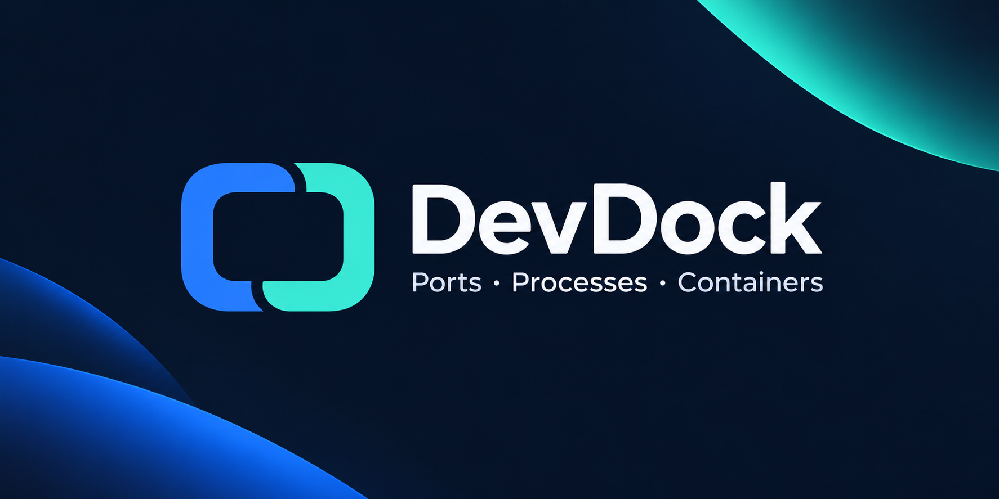
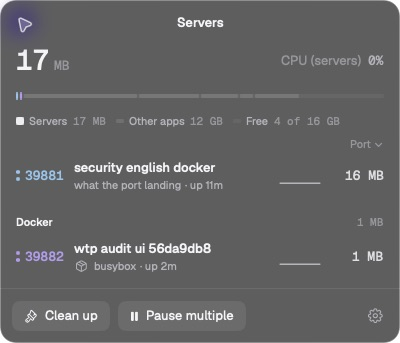

# DevDock

A native macOS menu bar app for local development ports, processes, Git worktrees, coding-agent sessions and Docker containers. Maintained by [George Levis](https://github.com/levgiorg).

[Source and issues](https://github.com/levgiorg/DevDock) · [Security review](docs/audit/REPORT.md) · [Verification](docs/audit/VERIFICATION.md) · [Brand assets](docs/brand/README.md)



- Discover local TCP listeners, PIDs, project folders, Git branches/worktrees and Claude Code session metadata.
- Inspect ports, resource usage and known local Docker runtime mappings, including configured stopped-container ports.
- Confirm Stop, Restart, Pause and Resume against freshly checked process/container identity. Shared, ambiguous and protected infrastructure is refused.
- Use English throughout the native app, terminal UI, website and documentation. User project names and paths preserve Unicode.
- Keep telemetry disabled, cleanup Off or Ask, notification permission user initiated, and automatic updates off by default.
- Use the coordinated Midnight icon, adaptive menu-bar template and GitHub artwork.

## Build locally

Apple Silicon and macOS 14 or newer are the packaging target. The verified host and platform limitations are listed in the verification report. Swift 6.2+ Command Line Tools and Node 22.18+ are required; the tests use a pinned Swift Testing dependency.

```sh
./DevDock/build-app.sh
open DevDock/.build/DevDock.app
./DevDock/make-dmg.sh
```

The disk image is `DevDock/.build/DevDock.dmg`. Local outputs are ad-hoc development artifacts and are not notarized distribution builds. Built apps, DMGs, credentials and test logs are excluded from Git.

For the optional terminal UI:

```sh
swift run --package-path DevDock DevDock --tui
swift run --package-path DevDock DevDock --tui list --json
```

The app can install the `wtp` terminal alias in `~/.local/bin`, without administrator permission or overwriting another command. It never installs a privileged helper.

## Website

```sh
npm ci --ignore-scripts
npm run dev
```

Open `http://localhost:3000`. The website runs locally; no public DevDock domain or deployment is configured. The download route only serves a locally built DevDock DMG placed in `public/DevDock.dmg`. Set `NEXT_PUBLIC_SITE_URL` before a separately approved deployment. Demo actions are simulated.

## Verify

```sh
./scripts/verify.sh
npm run test:browser
python3 scripts/live-integration.py
```

The live harness requires local Docker Desktop and mutates only its own uniquely labeled disposable fixtures. It never stops arbitrary user containers or processes. Native UI interaction, test evidence and exclusions are documented in [verification](docs/audit/VERIFICATION.md).

## Security and release controls

Process actions validate the current user, exact PID birth time, executable, directory and port ownership. Delayed force-quit refreshes those checks. Docker actions use bounded local Unix-socket requests and immutable full container IDs with fresh state/mapping inspection. Remote Docker contexts are unsupported. These safeguards reduce risk; they do not prove complete security.

Production deployment is manual. Publishing, notarization uploads, merges and deployments require separate approval. Release artifacts require Developer ID signing, hardened runtime, signed update metadata and accepted notarization. See [release setup](DevDock/UPDATES.md).

## License

[MIT](LICENSE), including George Levis's DevDock modifications. Required inherited copyright and dependency notices are retained in [LICENSE](LICENSE) and [THIRD_PARTY_NOTICES.md](THIRD_PARTY_NOTICES.md), and packaged with the app.
